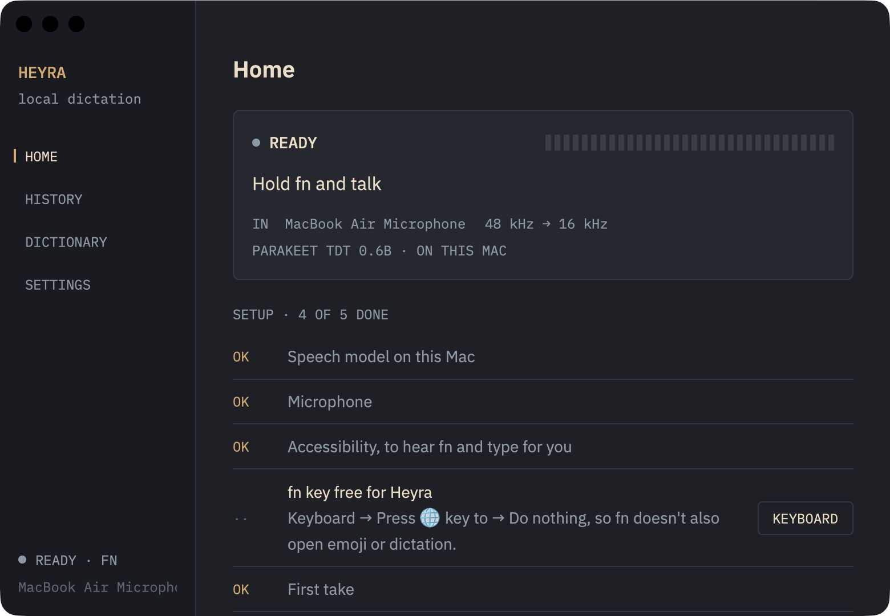

<p align="center"></p>

# Heyra

Hold **fn**, talk, let go. Your words are typed wherever your cursor is.

Heyra turns speech into text on your own Mac. It goes online once, to download the
voice model on first launch. After that your voice and your
words never leave the machine. No account, no subscription.

> **Proof of concept.** macOS on Apple Silicon only, for now.



## Install

1. With [Homebrew](https://brew.sh):

   ```sh
   brew install --cask alcun/tap/heyra
   ```

   No admin rights (a work Mac)? Install into your own Applications folder instead, for
   this and every upgrade:

   ```sh
   echo 'export HOMEBREW_CASK_OPTS="--appdir=~/Applications"' >> ~/.zshrc && source ~/.zshrc
   brew install --cask alcun/tap/heyra
   ```

   Or download `Heyra.zip` from [Releases](https://github.com/alcun/heyra-desktop/releases),
   unzip it and move **Heyra** to Applications. It isn't notarized by Apple yet, so the
   first time macOS blocks it: System Settings → Privacy & Security → **Open Anyway**.
2. Open Heyra from Applications. It also opens at login from now on (Settings can turn
   that off).
3. Heyra opens on Home with a short setup list. It ticks each step off as you go:
   - the voice model downloads (about 400 MB, once)
   - allow the microphone
   - turn on Heyra under Privacy & Security → Accessibility, so it can hear fn and type
   - set Keyboard → Press 🌐 key to → **Do nothing**, so fn doesn't also open emoji
4. Click into any text box, hold fn, say something, let go.

Heyra lives in the menu bar and as a small dark dot at the bottom of the screen. Click
the dot, or use the menu bar, to open your history and settings.

## What it does

- **Push to talk.** Hold fn. A glowing orb at the bottom of the screen shows it's
  listening. Let go and the text is pasted in, and your clipboard text is put back.
  Pressing another key while holding fn (fn+arrow, fn+delete), or Esc, cancels the take.
  A soft click marks the start and end of each take (Settings can turn it off).
- **Voice commands.** End a take with "press enter" and Heyra presses it after pasting.
  "New line" and "new paragraph" break the text; a take of just "scratch that" undoes the
  last one. In a terminal, takes don't end in a full stop.
- **Any button.** Settings → Another button: any key, key combo or extra mouse button
  also works as push-to-talk, alongside fn.
- **Hands-free.** Double-tap fn to start, tap fn once (or the ✓ by the orb) to stop and
  paste. The ✕ stops without pasting; the text is still kept in History.
- **Long takes.** Talk for up to 30 minutes in one go; long takes are written a minute
  at a time, about 5 s of writing per minute of speech.
- **Updates.** `brew upgrade --cask heyra`.
- **Fast.** Six seconds of speech becomes text in about 0.4 s on an M-series Mac.
- **Light.** About 2% of one CPU core at rest and 5% while you talk. The model stays
  loaded (about 1.3 GB of memory) so it's ready the moment you press fn.
- **History.** Every take is kept on your Mac. Click one to copy it again.
- **Dictionary.** Fix words it mishears: `a cappy bar => capybara`.
- **Any microphone.** Plug one in and Heyra switches to it, with a note above the dot.
  Settings lists your mics with a live level. Optionally mutes the Mac while you talk.
- **FX mic (TING).** A Teenage Engineering EP-2350 is push-to-talk with nothing else
  installed: choose its line-in as the mic and squeeze to talk. The bottom button presses
  Enter, the middle one undoes. Once per mic, plug it in over USB-C and choose Settings →
  Set up this FX mic: Heyra puts a small script and four tones on its disk (from
  [ting-wispr](https://github.com/alcun/ting-wispr)), backing up its files first.

Everything Heyra keeps is in `~/Library/Application Support/Heyra`.

## Build from source

You need Rust (`rustup`) and Xcode's command line tools.

```sh
git clone https://github.com/alcun/heyra-desktop.git
cd heyra-desktop
./bundle.sh            # builds target/Heyra.app
open target/Heyra.app
```

`bundle.sh` signs with your Apple Development certificate if you have one, so macOS
keeps your permissions between builds. Without one it signs ad hoc, and macOS will ask
for Accessibility again after each rebuild.

`target/release/heyra --file clip.wav` prints a transcript, to test the engine.

## How it works

- [GPUI](https://www.gpui.rs) for the interface (the framework Zed is built with).
- [sherpa-onnx](https://github.com/k2-fsa/sherpa-onnx) runs the voice model in the app
  itself, int8 on the CPU.
- A macOS event tap watches for fn, `cpal` records the microphone, and the text is
  pasted with a real ⌘V.

## Voice models

Pick one on the welcome screen, or any time in Settings:

- **Bark 3.0 Clean** (399 MB): English. Leaves out "um", "uh", false starts and
  repeats, so you get what you meant. The default on a Mac set to English.
- **Bark 3.0 Plus** (398 MB): English, every word, fewer mistakes than Parakeet on
  meetings and calls.
- **Parakeet v3** (487 MB): every word, in English and 24 European languages. The
  default otherwise.
- **Your own**: Settings → Use a model folder. Any sherpa-onnx transducer (encoder,
  decoder and joiner `.onnx` files and `tokens.txt`).

Switching downloads the new model while the current one keeps working. Models are
downloaded from this repository's releases and checked against a SHA-256 before use.

Bark 3.0 Clean and Plus are [Underdog's](https://huggingface.co/ConwayResearch/Underdog-Bark-3.0-Clean)
fine-tunes of NVIDIA's Parakeet TDT 0.6B v3, converted for sherpa-onnx. Measured with
[heyra-bench](https://github.com/alcun/heyra-bench) on 800 clips (% of words wrong):

| | Average | Off the cuff, against what was meant |
|---|--:|--:|
| Bark 3.0 Plus | 7.6 | 17.7 |
| Parakeet v3 | 8.1 | 17.5 |
| Bark 3.0 Clean | 9.9 | 6.1 |

Bark Clean's average is higher because those test transcripts keep every "um", which it
leaves out on purpose.

## Credits and licence

Heyra is MIT licensed. The model, runtime and fonts have their own licences; see
[NOTICE](NOTICE).
