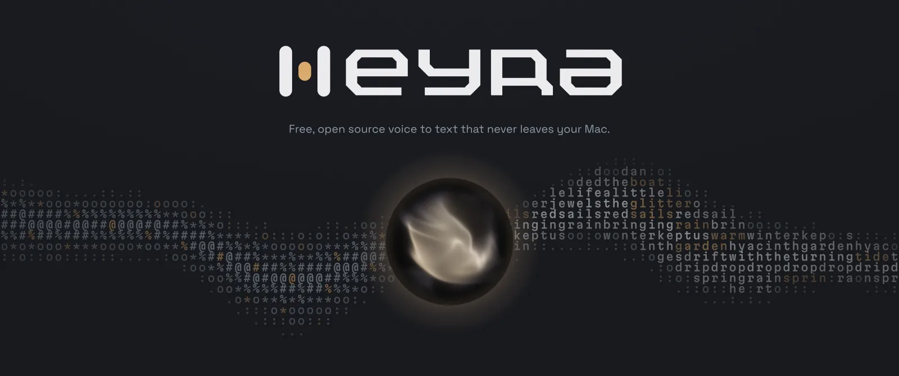
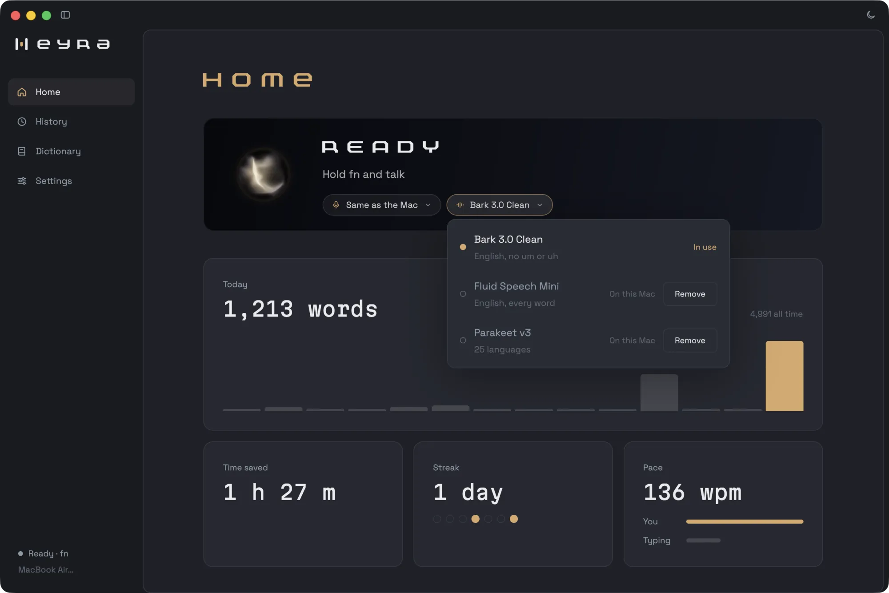
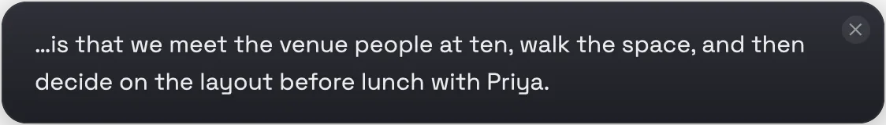
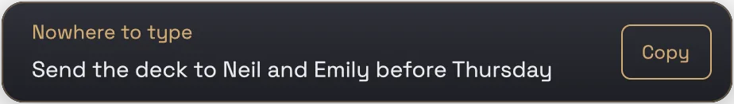

<p align="center"></p>

<p align="center">Hold fn, talk, let go. It types where your cursor is.</p>

<p align="center">
  <a href="https://github.com/alcun/heyra-desktop/releases/latest">Download</a> ·
  <a href="https://heyra.alcun.dev">Website</a> ·
  <a href="https://heyra.alcun.dev/bench">Bench</a>
</p>

```sh
brew install --cask alcun/tap/heyra
```

**0.5 s** from letting go to text · **5.6%** of words wrong, off the cuff · **25** languages · **0 bytes** of your voice leave your Mac

Heyra runs the voice model on your own Mac. It goes online once, to download the model,
and after that it works with Wi-Fi off. No account, no subscription, MIT licensed.
Apple Silicon only, for now.



## Install

With [Homebrew](https://brew.sh), as above. No admin rights? Install into your own
Applications folder:

```sh
echo 'export HOMEBREW_CASK_OPTS="--appdir=~/Applications"' >> ~/.zshrc && source ~/.zshrc
brew install --cask alcun/tap/heyra
```

Or download `Heyra.zip` from [Releases](https://github.com/alcun/heyra-desktop/releases)
and move Heyra to Applications. It's signed and notarized by Apple.

Open Heyra. Home ticks off each setup step:

1. The voice model downloads, about 400 MB, once
2. Allow the microphone
3. Turn Heyra on under Privacy & Security → Accessibility, so it can hear fn and type
4. Set Keyboard → Press 🌐 key to → Do nothing, so fn doesn't also open emoji

Then click into any text box, hold fn, say something and let go.

Installed with Homebrew, Heyra updates itself once a day, when you're not talking.

## Using it

Heyra lives in the menu bar and as a small dot above the Dock. Hold fn and your words
show as you talk. Let go and they're pasted where your cursor is, with your clipboard
put back.



If there's nowhere to type, Heyra keeps the take on a card for you to copy.



- Esc, or any other key while holding fn, cancels a take
- Double-tap fn to talk hands-free; tap again to stop
- Any key, combo or extra mouse button can be push-to-talk, in Settings
- Say "press enter", "new line" or "new paragraph"; "scratch that" undoes the last take
- In a terminal, takes don't end in a full stop
- History keeps every take, with its app, model and timing; click one to copy it
- The Dictionary fixes misheard words: `a cappy bar => capybara`
- Plug in any microphone and Heyra switches to it
- While dictating: mute or lower the Mac's sound
- The orb can sit at the bottom or the top of the screen
- Takes can run to 30 minutes

Heyra writes while you talk, so the wait stays around half a second however long you
spoke. At rest it uses about 2% of one core and 1.3 GB of memory.

A Teenage Engineering EP-2350 works as a push-to-talk mic: squeeze to talk, the bottom
button presses Enter. Settings → Set up this FX mic installs
[ting-wispr](https://github.com/alcun/ting-wispr) on it, after backing up its files.

Everything Heyra keeps is in `~/Library/Application Support/Heyra`.

## Voice models

Pick one in Settings or the menu bar. The current model keeps working while a new one
downloads.

| Model | Size | For | Average | Off the cuff |
|---|--:|---|--:|--:|
| Bark 3.0 Clean | 399&nbsp;MB | English, leaves out "um", "uh" and false starts | 9.3 | **5.6** |
| Fluid Speech Mini | 312&nbsp;MB | English, every word | **6.7** | 16.8 |
| Parakeet v2 | 460&nbsp;MB | English, meetings and calls | 7.3 | 16.2 |
| Parakeet v3 | 487&nbsp;MB | English and 24 European languages | 8.3 | 18.0 |

Words wrong in 100, fewer is better. "Off the cuff" is scored against what the speaker
meant, so Bark Clean's average counts the "um"s it leaves out on purpose. Measured with
[heyra-bench](https://github.com/alcun/heyra-bench) on 800 public clips; full results on
the [Bench](https://heyra.alcun.dev/bench).

Your own model: Settings → Use your own model, with a sherpa-onnx folder: Parakeet-style
transducers, Whisper, Canary, Moonshine, Qwen3-ASR or Cohere Transcribe.

Bark 3.0 Clean ([Underdog](https://huggingface.co/ConwayResearch/Underdog-Bark-3.0-Clean))
and Fluid Speech Mini ([FluidVoice](https://huggingface.co/FluidVoice-Labs/fluid-speech-mini-onnx))
are fine-tunes of NVIDIA's Parakeet TDT 0.6B v3, converted for sherpa-onnx.

## Build from source

You need Rust (`rustup`) and Xcode's command line tools.

```sh
git clone https://github.com/alcun/heyra-desktop.git
cd heyra-desktop
./bundle.sh            # builds target/Heyra.app
open target/Heyra.app
```

Without an Apple Development certificate, macOS asks for Accessibility again after
each rebuild. `target/release/heyra --file clip.wav` prints a transcript.

Built with [GPUI](https://www.gpui.rs) (Zed's UI framework) and
[sherpa-onnx](https://github.com/k2-fsa/sherpa-onnx), int8 on the CPU.

## Licence

Heyra is MIT licensed. The models, runtime and fonts have their own licences; see
[NOTICE](NOTICE).
